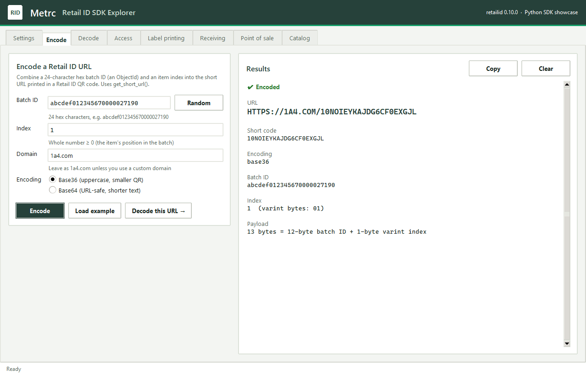
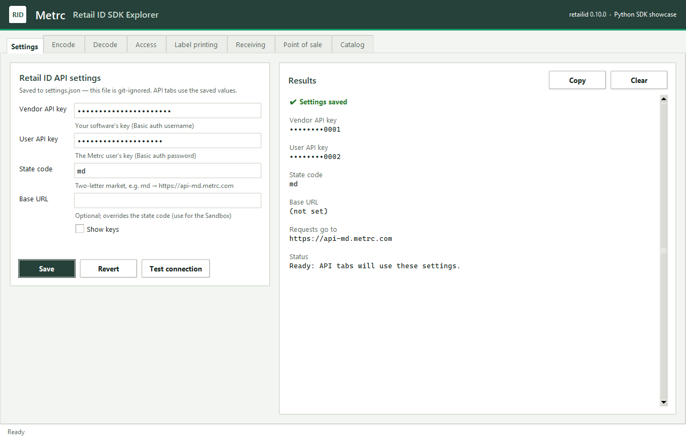
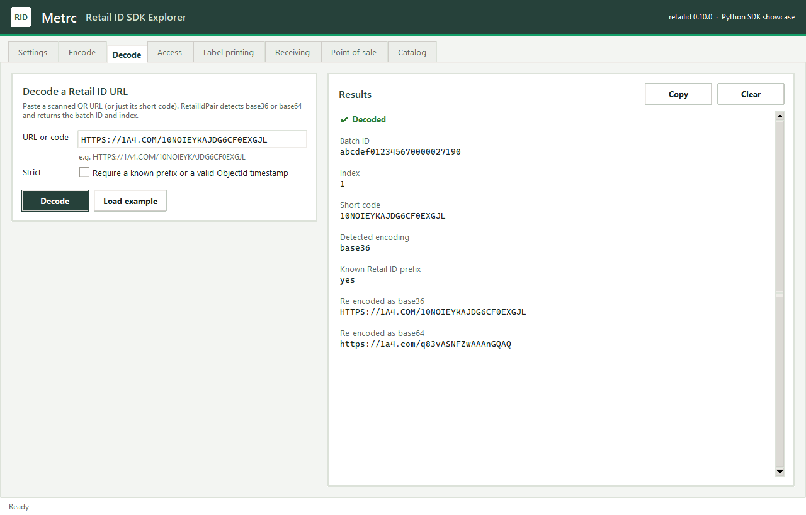
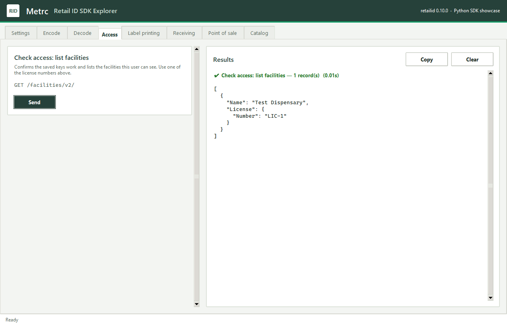
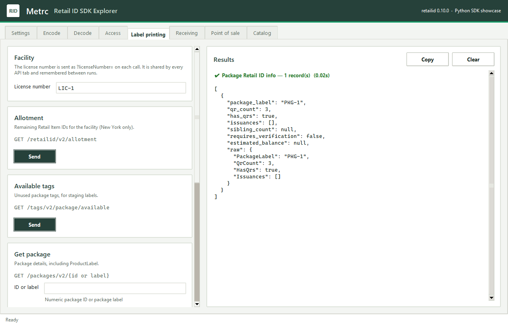
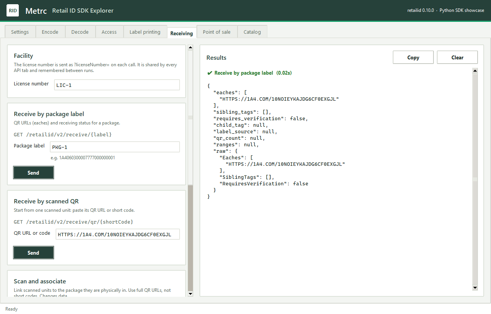
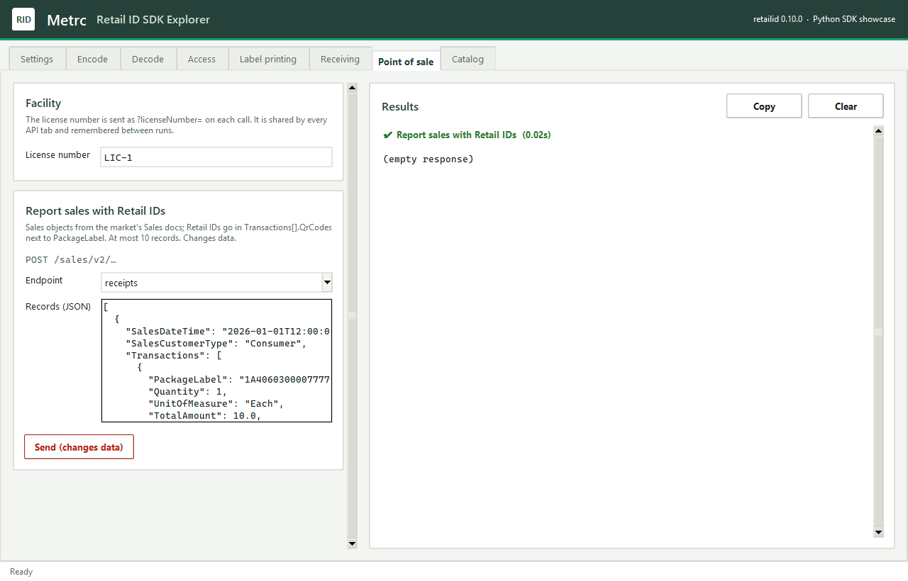
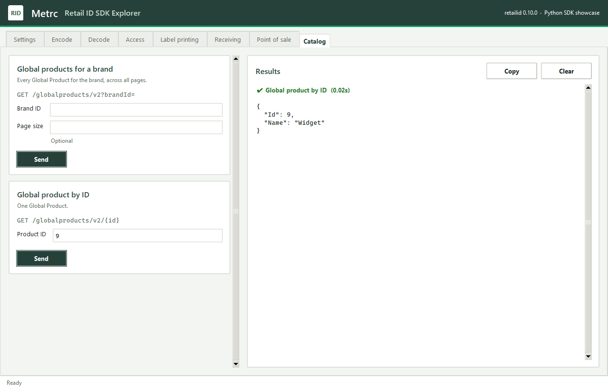

# rid-sdk-python-example

Example Python GUI app showcasing the rid-sdk features.

**Retail ID SDK Explorer** is a desktop app (Tkinter) for trying the Metrc
Retail ID Python SDK (`retailid`, from
[rid-sdk/python](https://github.com/nathanhouse-metrc/rid-sdk/tree/main/python)) without
writing code. Each SDK feature has inputs, action buttons and a results panel.

| Tab | SDK feature |
| --- | --- |
| **Settings** | Enter and save `vendor_api_key`, `user_api_key`, `state_code` and `base_url`; *Test connection* calls `get_facilities()` |
| **Encode** | `get_short_url(batch_id, index, domain, base64)`: batch ID + index → Retail ID URL (base36 or base64, custom domain) |
| **Decode** | `RetailIdPair(url, strict)` and `short_code_from_url()`: URL or short code → batch ID + index, re-encoded both ways |
| **Access** | `get_facilities()` |
| **Label printing** | `get_allotment()`, `get_available_tags()`, `get_package()`, `get_packages_info()`, `generate()` |
| **Receiving** | `receive()`, `receive_by_qr()`, `associate_package()`, `merge()` |
| **Point of sale** | `post_sales()` to any of the sales endpoints (`receipts`, `deliveries`, …) |
| **Catalog** | `get_global_products()`, `get_global_product()` |

Encode and Decode work offline. The API tabs use a `RetailIdClient` built from
the saved settings, and share one facility license number field. API calls run
in the background so the window stays responsive. Calls that change data in
Metrc (generate, associate, merge, sales) have a red *Send (changes data)*
button and ask for confirmation first.

## Screenshots



<details>
<summary>More screenshots</summary>

**Settings**: keys are masked once saved.



**Decode**: a scanned URL broken back into batch ID and index.



**Access**: checking the saved keys by listing facilities.



**Label printing**: Retail ID info for a package.



**Receiving**: QR URLs and status for a package.



**Point of sale**: reporting a sale with Retail IDs in `QrCodes`.



**Catalog**: one Global Product.



</details>

The API results in these screenshots come from the local fake API used by the
tests, not from Metrc. To regenerate them after changing the UI:

```bash
pip install pillow
python tools/take_screenshots.py
```

## Requirements

- Python 3.9 or newer, with Tkinter (included in the python.org installers for
  Windows and macOS; on Debian/Ubuntu install `python3-tk`).
- A local checkout of [rid-sdk](https://github.com/nathanhouse-metrc/rid-sdk) **next to
  this repository**:

  ```
  git/
  ├── rid-sdk/                  ← SDK checkout
  │   └── python/               ← the retailid package
  └── rid-sdk-python-example/   ← this repo
  ```

  The API tabs need the SDK's Retail ID API client (`retailid.api`). If your
  rid-sdk checkout does not have `python/src/retailid/api.py` yet, check out a
  branch that does (for example `python-api-1`).

## Look and feel

Colours and fonts follow the Metrc design used in Metrc's shared prototypes
(forest-green brand bar, warm off-white surfaces, Inter and IBM Plex Mono); all
of them are tokens in `rid_example/theme.py`. Inter and IBM Plex Mono are used
when installed (free from Google Fonts); otherwise the app falls back to Segoe
UI / Helvetica and Cascadia Mono / Consolas / Menlo.

## Install

The app depends on the SDK through an editable install of the local checkout
(`-e ../rid-sdk/python` in `requirements.txt`), so SDK changes are picked up
without reinstalling. If your rid-sdk checkout lives elsewhere, edit that path.

Windows (PowerShell):

```powershell
cd rid-sdk-python-example
python -m venv .venv
.venv\Scripts\Activate.ps1
pip install -r requirements.txt
```

macOS / Linux:

```bash
cd rid-sdk-python-example
python3 -m venv .venv
source .venv/bin/activate
pip install -r requirements.txt
```

## Run

With the virtual environment active, from the repository root:

```bash
python -m rid_example
```

On first launch the app opens on **Settings**. Fill in your keys and either a
`state_code` (e.g. `md` → `https://api-md.metrc.com`) or a `base_url` (which
overrides the state code; use it for the Sandbox), then **Save** and **Test
connection**.

## Where settings are stored

Settings are saved to `settings.json` in the repository root, using the same
keys as the SDK's `config.json`, so the file also works with
`RetailIdClient.from_config("settings.json")`. The app also remembers the last
facility license number there.

`settings.json` holds your API keys and is listed in `.gitignore`; never commit
it. To keep it somewhere else, set `RID_EXAMPLE_SETTINGS` to a file path before
starting the app.

## Tests

The tests drive every tab against the real SDK, with a local fake of the Retail
ID API, so they need no keys and change nothing in Metrc:

```bash
python -m unittest discover -s tests -t . -v
```

## Project layout

```
rid_example/
├── __main__.py     python -m rid_example
├── app.py          main window, Settings tab, background task runner
├── codec_tabs.py   Encode and Decode tabs
├── api_tabs.py     API tabs; one Action per RetailIdClient method
├── settings.py     load/save settings.json
├── theme.py        colours, fonts and ttk styles
└── widgets.py      cards, results panel, scrolling frame
tests/test_app.py   end-to-end tests with a fake API server
tools/take_screenshots.py   regenerates docs/screenshots/
```
